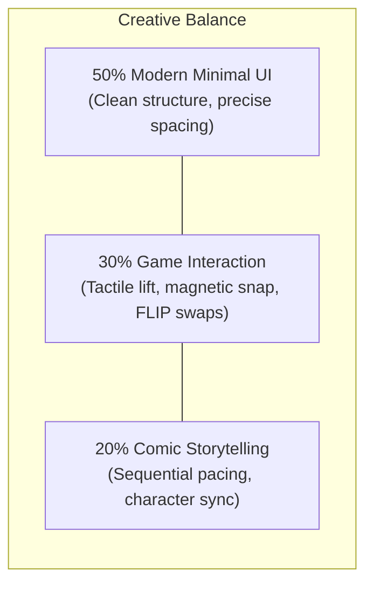
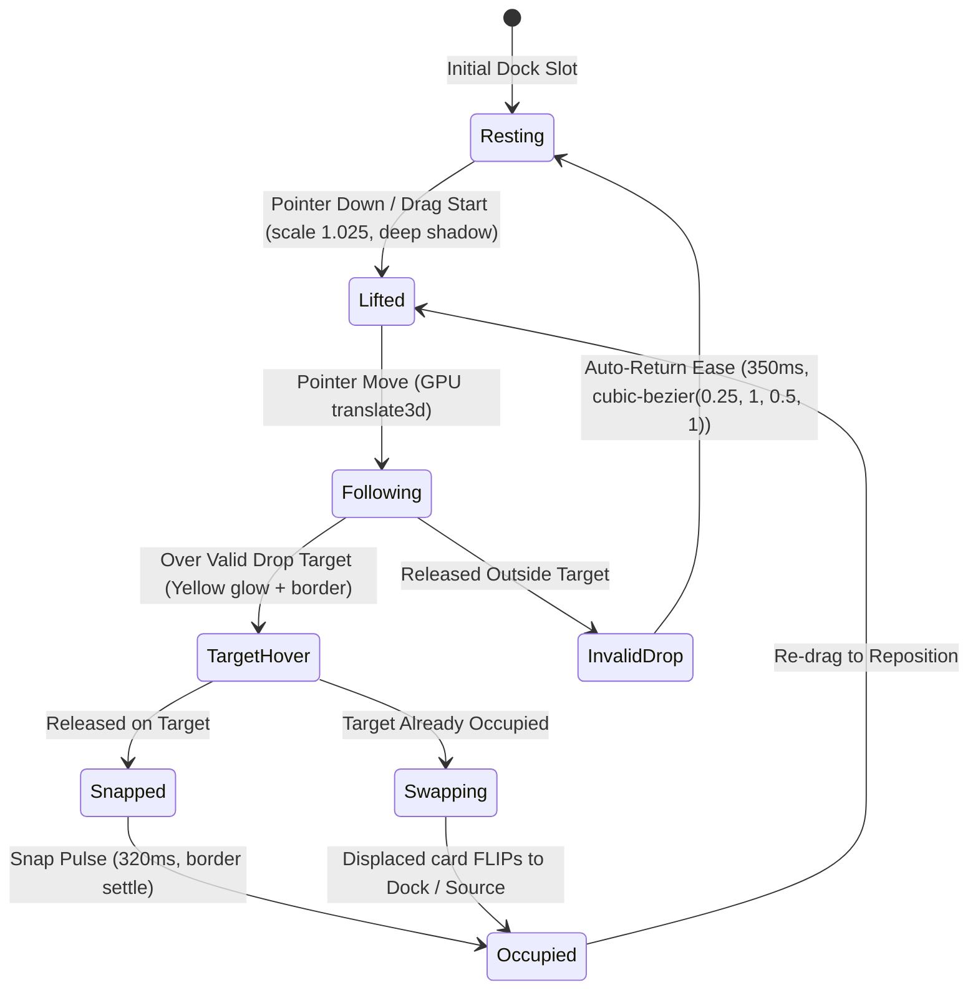
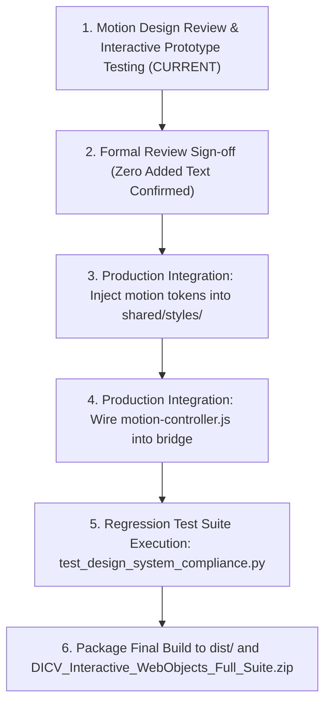

# DICV Interactive — Cinematic Animation & Motion System
**Comprehensive Motion Design Review, Prototype Specification & Implementation Plan**  
*Project Root:* `D:\Development\Projects\dicv-interactive`  
*Target Suite:* Q001–Q006 (Modern Minimal 50% + Game Interaction 30% + Comic Storytelling 20%)  
*Status:* Motion prototypes completed; production quiz code untouched pending approval.

---

## 1. Executive Summary & Creative Direction

The **Cinematic Animation & Motion System** transforms the DICV Interactive quiz suite into a polished, game-responsive learning experience while honoring the strict requirement of **Zero Additional Learner-Facing Text** and **100% Daimler Corporate Design System Compliance**.



### Core Principles
1. **Sequential Storytelling**: Elements never enter in a chaotic simultaneous burst. Each element fades, glides into position, and settles before or in overlapping harmony with the next element.
2. **Tactile Micro-Interactions**: Hover lifts ($\Delta y = -4\text{ px}$), springless checkbox pop animations ($220\text{ ms}$), and illuminated Daimler stadium buttons provide immediate physical feedback to the learner.
3. **Physics-Driven Drag & Drop**: Card pickup elevation, fluid pointer tracking, smooth eased invalid-drop returns without shake penalties, magnetic target snaps, and atomic FLIP (First-Last-Invert-Play) card swaps.
4. **Post-Feedback Answer Reveal Sequencer**: Answers are revealed **strictly after** Articulate Storyline 360 completes its Meister/Torq/Aura character feedback layer, preventing cognitive overload and premature outcome disclosure.
5. **Universal Accessibility**: Strict WCAG 2.1 AA compliance with automatic `@media (prefers-reduced-motion: reduce)` support, GPU-accelerated compositing (`transform`, `opacity`), and zero layout shifts.

---

## 2. Motion Design Tokens & Easing Curves

All animation curves use smooth deceleration curves aligned with Daimler precision engineering, avoiding cartoonish bounces or distracting oscillations:

| Token | Timing / Curve | Purpose | Mathematical Curve |
| :--- | :--- | :--- | :--- |
| `--ease-cinematic-out` | `cubic-bezier(0.16, 1, 0.3, 1)` | Fluid deceleration without bounce (entrance, snap) | Smooth cubic ease-out |
| `--ease-return` | `cubic-bezier(0.25, 1, 0.5, 1)` | Restorative natural return for invalid drag drops | Low-friction deceleration |
| `--ease-pickup` | `cubic-bezier(0.2, 0, 0, 1)` | Immediate reactive response when user lifts a card | Fast ramp ease-out |
| `--ease-reveal` | `cubic-bezier(0.4, 0, 0.2, 1)` | Controlled progressive focus transition for answer reveal | Symmetric ease |
| `--ease-micro` | `cubic-bezier(0.34, 1.56, 0.64, 1)` | Checkbox pop & micro-interaction settle | Controlled subtle overshoot |

### Standard Sequential Entrance Delays

```
Header (0ms) ──────────[450ms]
Diagram (100ms) ──────────────────[550ms]
Instruction (200ms) ────────[400ms]
Card 1 (320ms) ───────[350ms]
Card 2 (500ms) ───────[350ms]
Card 3 (680ms) ───────[350ms]
Card 4 (860ms) ───────[350ms]
Submit (1200ms) ─────[300ms]
                     ▲
                     Input interactive as soon as cards settle (~1.1s)
```

---

## 3. Quiz-Specific Motion Choreography

### Q001 — Accident Prediction ($806 \times 962\text{ px}$)
1. **Header**: Question title glides up $+14\text{ px} \to 0\text{ px}$ with fade in ($450\text{ ms}$). Yellow accent bar illuminates.
2. **Subtitle Instruction**: Instruction row glides in ($400\text{ ms}$, delay $100\text{ ms}$).
3. **Photograph Cards (A–D)**: Enter sequentially in vertical stack ($350\text{ ms}$ each, $180\text{ ms}$ stagger). Each card settles with its resting shadow.
4. **Submit Area**: Stadium button glides in ($300\text{ ms}$) in illuminated Dark Petrol resting state ($45\%$ opacity).
5. **Selection**: Hover raises card by $-4\text{ px}$. Clicking triggers $220\text{ ms}$ Daimler Yellow checkbox pop with black checkmark.
6. **Post-Feedback Reveal**: Once Storyline authorizes review, all 4 cards pulse with correct green glow (`#008248`, `#E8F7ED`), reflecting that any employee can experience an accident.

### Q002 — 5 Safety Commitments ($1110 \times 900\text{ px}$)
1. **Header Tab**: Upright Dark Petrol tab fades in and rises ($450\text{ ms}$).
2. **Subtitle Instruction**: Fades in with soft slide ($400\text{ ms}$).
3. **5 Icon Cards (3+2 Reading Order)**:
   - Top row (Cards 1, 2, 3) enters left-to-right ($350\text{ ms}$ each, $180\text{ ms}$ stagger).
   - Bottom row (Cards 4, 5) follows seamlessly in reading order.
4. **Submit Row**: Daimler stadium pill settles at the bottom.
5. **Selection**: Selected cards illuminate with yellow accent borders and elevate by $-3\text{ px}$.
6. **Post-Feedback Reveal**: All 5 cards sequence into green approved state.

### Q003 — EHS Commitments ($1110 \times 900\text{ px}$)
1. **Instruction Header**: Upright question prompt glides up ($450\text{ ms}$).
2. **5 Commitment Cards**: Cascade vertically/grid ($350\text{ ms}$ each, $180\text{ ms}$ stagger).
3. **Max-4 Selection Constraint Transition**:
   - Selecting cards toggles smooth active state.
   - When the 4th card is selected, the remaining 5th card smoothly transitions to disabled (`opacity: 0.45; filter: grayscale(30%)`) with a $200\text{ ms}$ fade, preventing rule confusion without jarring alerts.
4. **Post-Feedback Reveal**: Cards 0, 1, 2, and 4 pulse green; distractor 3 settles into soft red border.

### Q004 — EHS Focus Areas ($1536 \times 1024\text{ px}$)
1. **Header**: Title fades and rises ($450\text{ ms}$).
2. **Pinwheel Diagram**: Central 4-quadrant pinwheel scales smoothly from $0.96 \to 1.0$ ($550\text{ ms}$).
3. **Drop Zones**: 3 designated drop zones (Governance, Capability, Risk) fade in over pinwheel petals ($400\text{ ms}$).
4. **Dock Tray & Cards**: Focus area cards (A, B, C, D) enter in right-hand sidebar.
5. **Drag Physics**:
   - **Pickup**: Scale $1.025$, shadow increases to $0\text{ }18\text{px }36\text{px rgba}(0,67,85,0.26)$, dock displays subtle dashed placeholder.
   - **Invalid Drop Auto-Return**: Released outside a drop zone $\to$ card smoothly glides back to its source slot in $350\text{ ms}$ via `--ease-return`. No error dialog, no screen shake.
   - **Successful Drop Snap**: Absorbed into target in $320\text{ ms}$ with yellow highlight pulse on target border.
   - **Atomic FLIP Swap**: If target is already occupied, the displaced card glides back to dock (or to source target) via GPU FLIP inversion without flicker or overlap.

### Q005 — Safety Culture Maturity ($1110 \times 640\text{ px}$)
1. **Header**: Question prompt glides up ($450\text{ ms}$).
2. **Bradley Curve Path-Draw**: SVG path animates via `stroke-dashoffset` ($900\text{ ms}$, `--ease-cinematic-out`), tracing the maturity curve from left to right without displaying misleading numerical percentages.
3. **4 Stage Checkpoints**: 4 circular target anchors appear along the curve ($400\text{ ms}$).
4. **Dock Tray**: 4 stage cards (Reactive, Dependent, Independent, Interdependent) fade and elevate in bottom dock.
5. **Drag Physics**: Smooth pickup, magnetic target snap ($320\text{ ms}$), and auto-return on invalid placement.
6. **Post-Feedback Reveal**: Correct stage positions reveal in strict sequence: Reactive $\to$ Dependent $\to$ Independent $\to$ Interdependent.

### Q006 — Safety Review Structure ($1024 \times 576\text{ px}$)
1. **Issue Counter & Progress Bar**: Counter ("Safety Issue 1 of 3") and cyan progress strip fade in ($450\text{ ms}$).
2. **Issue Illustration**: Technical scenario icon glides in from left with soft fade ($550\text{ ms}$).
3. **Scenario Text Box**: Contextual description enters ($400\text{ ms}$).
4. **3 Committee Cards**: Apex, Sub-Committee, and Ad-Hoc cards cascade vertically ($350\text{ ms}$ each, $180\text{ ms}$ stagger).
5. **Post-Feedback Reveal**: Round 1 Apex Committee pulses with green approval glow; R2 and R3 follow identical motion parameters for Sub and Ad-Hoc committees respectively.

---

## 4. Drag & Drop Physics & FLIP Swapping (Q004 & Q005)

### Drag Lifecycle Architecture


### FLIP Swap Algorithm
```javascript
// First: Record initial bounding boxes
const firstA = cardA.getBoundingClientRect();
const firstB = cardB.getBoundingClientRect();

// Last: Execute logical state mutation in DOM
dockOrTarget.appendChild(cardA);
sourceTarget.appendChild(cardB);

const lastA = cardA.getBoundingClientRect();
const lastB = cardB.getBoundingClientRect();

// Invert: Apply transform offsets
cardA.style.transform = `translate(${firstA.left - lastA.left}px, ${firstA.top - lastA.top}px)`;
cardB.style.transform = `translate(${firstB.left - lastB.left}px, ${firstB.top - lastB.top}px)`;

// Play: Animate back to natural 0,0
requestAnimationFrame(() => {
  cardA.classList.add('motion-flip-transition');
  cardB.classList.add('motion-flip-transition');
  cardA.style.transform = '';
  cardB.style.transform = '';
});
```

---

## 5. Storyline Character Synchronization & Event Contract

All character art (Meister, Torq, Aura), speech bubbles, and sound effects remain strictly inside Storyline 360 layers. The HTML Web Object notifies Storyline via `DICVStorylineBridge` events:

| Event Name | Trigger Condition | Storyline Character Action |
| :--- | :--- | :--- |
| `QUIZ_ENTRANCE_START` | HTML container mounts and begins animation | Character adopts attentive neutral pose on shopfloor layer |
| `QUIZ_ENTRANCE_COMPLETE` | All cards settled, input ready ($t \approx 1.2\text{s}$) | Character gestures subtly toward interactive board |
| `QUIZ_CARD_SELECTED` | Learner clicks an option card | Character acknowledges action (eye gaze shift) |
| `QUIZ_DROP_SUCCESS` | Learner drops a card into valid target | Character shows confident nod |
| `QUIZ_SUBMIT_REQUEST` | Learner clicks Submit | Storyline displays character speech bubble feedback layer |
| `QUIZ_REVEAL_ANSWERS` | Storyline feedback completes & authorizes review | Character transitions to instructional debrief pose while HTML highlights answers |

> [!IMPORTANT]
> **No Blocking**: Learners are never blocked from selecting answers while Storyline character animations play. Interaction becomes available as soon as the HTML elements visibly settle.

---

## 6. Revisit & LMS Resume Rules

1. **Initial Visit**: Plays the full cinematic sequential entrance once.
2. **LMS Resume / Completed State**:
   - Bridge checks `<QuizID>_Done` or `<QuizID>_Revealed`.
   - If true, the container instantly applies `.motion-instant-ready`.
   - Entrance animation is **bypassed immediately** ($0\text{ ms}$).
   - Correct and submitted states render in their settled review appearance without re-triggering reveal animations, audio cues, score recalculations, or Life Meter increments.
3. **Authorized New Attempt (Retry)**: Full sequential entrance may play again upon explicit bridge `RESET` event.

---

## 7. Accessibility & Performance Verification

- **Reduced Motion Support**:
  ```css
  @media (prefers-reduced-motion: reduce) {
    *, *::before, *::after {
      animation-duration: 0.01ms !important;
      transition-duration: 0.01ms !important;
    }
    .motion-animate-in {
      opacity: 1 !important;
      transform: none !important;
    }
  }
  ```
- **Zero Layout Shifts**: All movements use CSS `transform` (`translateY`, `scale`) and `opacity`. No layout recalculations (`top`, `margin`, `width`).
- **No Flash / Strobe**: All color transitions use minimum $220\text{ ms}$ durations with soft contrast, avoiding photosensitivity risks.
- **Keyboard Navigation**: Native tab order preserved. Pressing Space/Enter triggers the same visual micro-interactions as mouse clicks.

---

## 8. Interactive Motion Prototypes & Visual Verification

### Standardized Suite Canvas Geometry
* **Q001**: **$806 \times 962\text{ px}$** — *The Approved Single Exception (Portrait Framed Card Layout)*.
* **Q002 through Q006**: **$1110 \times 960\text{ px}$** — *Standardized Widescreen Corporate Suite Canvas*.

All prototypes run at exact calibrated resolutions in `WebObjects/prototypes/motion/`:

| Prototype | Target Quiz | Canvas Standard | Status | Verified Screenshot Link |
| :--- | :--- | :--- | :--- | :--- |
| **Motion Hub** | Interactive Suite Control Lab | $1500 \times 1050\text{ px}$ | Ready | [motion_hub_preview.png](file:///C:/Users/CIE/.gemini/antigravity/brain/4030faa2-1380-4647-982b-d73a06809da8/motion_hub_preview.png) |
| **Q001** | Accident Prediction | **$806 \times 962\text{ px}$** | **Single Exception** | [motion_q001_entrance.png](file:///C:/Users/CIE/.gemini/antigravity/brain/4030faa2-1380-4647-982b-d73a06809da8/motion_q001_entrance.png) |
| **Q002** | 5 Safety Commitments | **$1110 \times 960\text{ px}$** | **Standardized** | [motion_q002_entrance_1110x960.png](file:///C:/Users/CIE/.gemini/antigravity/brain/4030faa2-1380-4647-982b-d73a06809da8/motion_q002_entrance_1110x960.png) |
| **Q003** | EHS Commitments | **$1110 \times 960\text{ px}$** | **Standardized** | [motion_q003_entrance_1110x960.png](file:///C:/Users/CIE/.gemini/antigravity/brain/4030faa2-1380-4647-982b-d73a06809da8/motion_q003_entrance_1110x960.png) |
| **Q004** | EHS Focus Areas | **$1110 \times 960\text{ px}$** | **Standardized** | [motion_q004_pinwheel_1110x960.png](file:///C:/Users/CIE/.gemini/antigravity/brain/4030faa2-1380-4647-982b-d73a06809da8/motion_q004_pinwheel_1110x960.png) |
| **Q005** | Safety Culture Maturity | **$1110 \times 960\text{ px}$** | **Standardized** | [motion_q005_bradley_1110x960.png](file:///C:/Users/CIE/.gemini/antigravity/brain/4030faa2-1380-4647-982b-d73a06809da8/motion_q005_bradley_1110x960.png) |
| **Q006** | Safety Review Structure | **$1110 \times 960\text{ px}$** | **Standardized** | [motion_q006_committee_1110x960.png](file:///C:/Users/CIE/.gemini/antigravity/brain/4030faa2-1380-4647-982b-d73a06809da8/motion_q006_committee_1110x960.png) |

---

## 9. Implementation Plan & Approval Gates



### Next Steps Upon User Sign-Off:
1. Merge `motion-design-system.css` into `WebObjects/shared/styles/motion.css`.
2. Connect `motion-controller.js` into each quiz's build pipeline.
3. Run the automated design compliance test suite to guarantee zero regressions.
